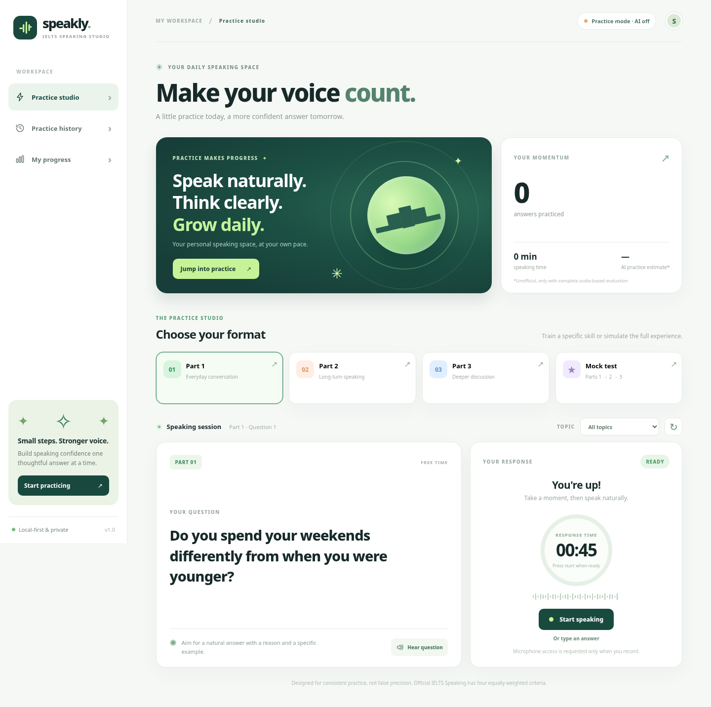

# Speakly — IELTS Speaking AI Coach

**Luyện IELTS Speaking trên trình duyệt bằng micro, Groq Whisper và GPT-OSS.** Chạy local với Docker Compose; có Part 1, Part 2, Part 3, Mock Practice, nhận xét ngôn ngữ và lịch sử luyện tập.

> [!IMPORTANT]
> Đây là ứng dụng **luyện tập không chính thức**, không liên kết với IELTS / British Council / IDP. Điểm "AI Language Estimate" chỉ là **ước lượng học tập từ transcript**, **không phải IELTS Speaking band**. App **không chấm phát âm** vì Whisper chỉ chuyển tiếng nói thành chữ.



## 1. Cài đặt nhanh trên Windows (Docker, khuyên dùng)

### Cần chuẩn bị

- **[Docker Desktop](https://docs.docker.com/desktop/setup/install/windows-install/)** (đã cài và đang chạy; chọn Linux containers mặc định).
- **Chrome hoặc Edge** và một micro hoạt động tốt.
- Internet để tải image Docker và sử dụng Groq API.
- **Groq API key của riêng bạn** — cách lấy ngay bên dưới. Không cần cài Python hay pip trên Windows khi dùng Docker.

### Bước 1 — Tạo Groq API key miễn phí

> **Groq** ([console.groq.com](https://console.groq.com)) là dịch vụ API được dự án sử dụng; **khác với Grok của xAI**.

1. Mở **https://console.groq.com/** và đăng nhập hoặc tạo tài khoản.
2. Ở góc trên, chọn **Personal / Project** muốn sử dụng (có thể để **Default Project**).
3. Vào **[API Keys](https://console.groq.com/keys)** → **Create API Key**.
4. Điền **Display Name** (ví dụ `speakly-local`). Ở **Expiration**, có thể chọn thời hạn phù hợp; `No expiration` là tùy chọn nhưng cần giữ key cẩn thận.
5. Bấm **Submit**, sau đó **Copy** API key. Key thường bắt đầu bằng `gsk_`. Hãy lưu lại ngay vì không nhất thiết xem lại toàn bộ key được.
6. Mỗi người dùng nên **tạo key riêng**; không gửi key của mình qua chat, ảnh chụp, GitHub hoặc ZIP chia sẻ cho người khác.

Tài liệu chính thức: [Groq Quickstart](https://console.groq.com/docs/quickstart) · [API Keys](https://console.groq.com/keys).

### Bước 2 — Tạo file `.env` và điền key

**Nếu tải source từ GitHub hoặc bản ZIP chia sẻ:** mở PowerShell **trong thư mục có `compose.yaml`**, chạy:

```powershell
Copy-Item .env.example .env
notepad .env
```

Nếu `.env` đã tồn tại thì **chỉ mở/sửa**, không copy đè làm mất key cũ.

Trong `.env`, điền **key của chính bạn** sau dấu `=`:

```dotenv
GROQ_API_KEY=gsk_YOUR_OWN_KEY_HERE
LLM_PROVIDER=groq
GROQ_MODEL=openai/gpt-oss-20b
GROQ_STT_MODEL=whisper-large-v3-turbo
STT_PROVIDER=groq
WHISPER_MODEL=base.en
APP_DATA_DIR=./data
```

`gsk_YOUR_OWN_KEY_HERE` chỉ là ví dụ, **không phải key thật**. Lưu file bằng tên **`.env`**, không phải `.env.txt` (trên Windows nên bật **View → File name extensions**).

**Lưu ý:** `.env` chứa secret, đã nằm trong `.gitignore` và `.dockerignore`. **Tuyệt đối không commit hoặc nén `.env` đã điền key khi chia sẻ project.** Chỉ chia sẻ `.env.example` với key trống.

### Bước 3 — Khởi động ứng dụng

1. Mở **Docker Desktop**, đợi Docker Engine chạy.
2. Trong thư mục project, chạy:

```powershell
docker compose up --build -d --wait
```

3. Khi container sẵn sàng, mở **http://127.0.0.1:8000** trên Chrome hoặc Edge.

**Cách dễ hơn:** double-click `start_windows.bat`. Script sẽ kiểm tra Docker, tạo `.env` mẫu nếu chưa có, build image, khởi động và mở trình duyệt. **Nhớ điền key rồi khởi động lại** để dùng AI.

**Không cần chạy `pip install -r requirements.txt` trên máy Windows.** Trong Dockerfile, Docker **tự cài requirements** vào image khi build. Nếu sửa code hoặc thư viện, chạy lại lệnh có `--build`.

### Bước 4 — Kiểm tra ứng dụng

- Mở **http://127.0.0.1:8000/api/health**. Trả về `"ok": true` nghĩa là backend đang chạy, **chưa chứng minh Groq key hợp lệ**.
- Trong giao diện, vào luyện tập và thử một câu. Để kiểm tra **Groq thực sự hoạt động**, phải nhấn **Analyze my answer** với bản ghi âm hoặc transcript hợp lệ.
- Khi gặp lỗi, chạy `docker compose logs --tail=100 speakly` và đọc thông báo (không đưa API key vào log gửi người khác).

## 2. Hướng dẫn sử dụng Speakly

| Chế độ | Mục đích | Thời gian trong app |
|---|---|---|
| **Part 1** | Câu hỏi đời sống, học tập, sở thích | 45 giây/câu |
| **Part 2** | Chủ đề dài, có cue points | 1 phút chuẩn bị, tối đa 2 phút nói |
| **Part 3** | Câu hỏi phân tích, lập luận, so sánh | 60 giây/câu |
| **Mock test** | Chuỗi luyện tập Part 1 → 2 → 3 | Bản rút gọn 10 câu, không phải bài thi thật |

**Luồng luyện tập đề xuất:**

1. Chọn **Part** hoặc **Mock test**, chọn **Topic** hoặc để tất cả chủ đề.
2. Nhấn **Hear question** nếu muốn nghe câu hỏi. Nút này dùng giọng TTS của trình duyệt, **không gọi Groq API**.
3. Chọn đúng **Microphone**, bấm **Test mic** nếu cần. Thanh mức âm phải chuyển động khi bạn nói.
4. Nhấn **Start speaking**, cho phép quyền micro, nói tiếng Anh, rồi nhấn **Finish recording** hoặc chờ hết thời gian.
5. Ở **Review your answer**, bấm Play để tự nghe lại. Nếu muốn tự động chép lời, **để trống Your transcript**.
6. Bấm **Analyze my answer**. **Không cần tích checkbox**: khi transcript trống, thao tác này cho phép app gửi audio tới **Groq Whisper** để chép lời, sau đó gửi transcript tới **GPT-OSS** để nhận xét.
7. Xem **Your feedback**, **What's working**, **Your next moves**, câu gợi ý và bài luyện tập. Chuyển sang **Next question** hoặc xem **Practice history / My progress**.

**Nếu tự nhập transcript:** Groq không cần nghe audio; khi nhấn Analyze và AI đang bật, app gửi **văn bản** lên GPT-OSS để nhận xét. Không cần trả phí API để nghe lại bản ghi hoặc đổi câu hỏi có sẵn.

**Các chỉ số:** Words Spoken, Words/Min, Long Pauses và Fillers chỉ là thống kê hỗ trợ luyện tập. Model văn bản **không nghe âm thanh gốc**, nên **Pronunciation = N/A** và điểm không phải band IELTS chính thức.

> **Mẹo:** Nếu chuyển sang câu khác sau khi ghi âm, hãy chắc chắn rằng transcript và câu hỏi đang đánh giá khớp nhau. AI chỉ chấm đúng đầu vào mà ứng dụng gửi tới nó; nội dung lạc đề sẽ không tự biến thành câu trả lời đúng.

## 3. Groq tốn bao nhiêu request? Có miễn phí không?

Groq có **Free Tier với hạn mức**. Khi đạt giới hạn, dịch vụ có thể báo `HTTP 429`; không nên hiểu “miễn phí” là sử dụng vô hạn. Hạn mức cụ thể phụ thuộc model/project và có thể thay đổi. Kiểm tra **[Settings → Limits](https://console.groq.com/settings/limits)** và **[Dashboard → Usage](https://console.groq.com/dashboard/usage)** của tài khoản đang sử dụng.

| Hành động | Groq API calls thông thường |
|---|---:|
| Chọn câu hỏi, nghe câu hỏi, ghi âm, nghe lại, Test mic | **0** |
| Nhập sẵn transcript rồi nhấn Analyze | **1** (GPT-OSS) |
| Ghi âm, để trống transcript rồi nhấn Analyze | **2** (Whisper + GPT-OSS) |
| **Retry AI feedback** cho transcript đã lưu | **1** (GPT-OSS; không chạy lại Whisper) |

**Ví dụ hạn mức tham khảo tại thời điểm viết (30/10/2026):**

| Model | Requests/phút | Requests/ngày | Giới hạn khác |
|---|---:|---:|---|
| `openai/gpt-oss-20b` | 30 | 1.000 | 8.000 tokens/phút; 200.000 tokens/ngày |
| `whisper-large-v3-turbo` | 20 | 2.000 | 7.200 giây audio/giờ; 28.800 giây audio/ngày |

Đây là **trần hạn mức**, không phải số lượt còn lại. Request thành công vẫn sử dụng token/giây audio, và có thể chạm giới hạn **token trước giới hạn request**. Biểu đồ **Metrics → Last 30 minutes** không đại diện cho tổng sử dụng cả ngày. Xem bảng **Usage** và giới hạn của chính project để theo dõi.

Tài liệu: [Groq Rate Limits](https://console.groq.com/docs/rate-limits) · [Supported Models](https://console.groq.com/docs/models).

## 4. Lệnh Docker thường dùng

Chạy trong thư mục chứa `compose.yaml`:

```powershell
docker compose ps                         # Kiểm tra trạng thái
docker compose logs --tail=100 speakly    # Xem lỗi gần nhất
docker compose logs -f speakly            # Theo dõi log
docker compose down                       # Dừng ứng dụng
docker compose up -d --wait               # Khởi động lại (không build)
docker compose up --build -d --wait       # Build lại sau khi sửa code
docker compose up -d --force-recreate     # Nạp .env mới sau khi đổi API key
```

Có thể dùng `stop_windows.bat` để dừng, `start_windows.bat` để khởi động. **Đừng chạy Docker và Python local cùng lúc trên cổng 8000**.

### Lịch sử và nâng cấp phiên bản

Compose gắn thư mục Windows **`./data`** vào **`/data`** trong container; database nằm ở **`data/practice.db`**. Rebuild image hoặc `docker compose down` thông thường **không xóa lịch sử**. Khi đổi thư mục project hoặc chuyển máy:

1. Dừng app bằng `docker compose down`.
2. Sao lưu `data/practice.db` sang nơi an toàn.
3. Chép database vào thư mục `data/` của bản mới **trước khi khởi động**.

Không chia sẻ `data/practice.db` với người khác nếu nó chứa transcript và thông tin luyện nói riêng tư. Trên Linux, thư mục bind mount cần quyền ghi cho UID `10001` của container.

## 5. Không dùng Docker (tùy chọn)

Máy Windows có Python 3.12 và pip có thể chạy file `start_python_windows.bat`, hoặc dùng:

```powershell
py -m venv .venv
.\.venv\Scripts\python.exe -m pip install -r requirements.txt
.\.venv\Scripts\python.exe run.py
```

Mở **http://127.0.0.1:8000**. Khi chạy local, chỉ nên cài thêm `requirements-local-stt.txt` nếu thực sự muốn dùng **Faster-Whisper offline**. Dockerfile mặc định **không cài model Whisper local**; cấu hình `STT_PROVIDER=groq` là lựa chọn đơn giản nhất.

## 6. Cấu hình nâng cao

Các biến trong `.env`:

| Biến | Mặc định | Chức năng |
|---|---|---|
| `GROQ_API_KEY` | Trống | Key riêng của mỗi người, chỉ dùng phía server |
| `LLM_PROVIDER` | `groq` | `groq` chấm văn bản hoặc `none` để tắt AI feedback |
| `GROQ_MODEL` | `openai/gpt-oss-20b` | Model chấm văn bản |
| `GROQ_STT_MODEL` | `whisper-large-v3-turbo` | Model nhận diện tiếng Anh |
| `STT_PROVIDER` | `groq` | `groq`, `auto`, `whisper`, `none` |
| `WHISPER_MODEL` | `base.en` | Model offline nếu có cài Faster-Whisper |
| `APP_DATA_DIR` | `./data` | Thư mục SQLite; Docker Compose override thành `/data` |

`STT_PROVIDER=auto` ưu tiên Whisper local **nếu có cài**, còn không thì dùng Groq. `STT_PROVIDER=whisper` chỉ hoạt động nếu đã cài Faster-Whisper; `none` yêu cầu nhập transcript thủ công. **Không có Groq key:** vẫn dùng được phần câu hỏi/thu âm và nhập transcript, nhưng không có cloud STT/AI feedback.

## 7. Sửa lỗi thường gặp

| Triệu chứng | Cách xử lý |
|---|---|
| **Docker is not running / Engine unavailable** | Mở Docker Desktop, đợi Engine hoạt động. Kiểm tra `docker info`. |
| **Port 8000 already in use** | Dừng server/container cũ; hoặc đổi cổng phía Windows trong `compose.yaml`. |
| **AI off / AI feedback unavailable** | Điền đúng `GROQ_API_KEY` trong `.env`, chạy `docker compose up -d --force-recreate`. |
| **Groq 401 / 403** | Key sai hoặc không đủ quyền. Tạo key mới tại Groq API Keys. |
| **Groq 429** | Chạm quota request/token/audio; xem Limits và Usage, chờ reset. |
| **Groq 400 / 404** | Kiểm tra model ID, JSON format và thông báo thực tế trong `docker compose logs --tail=100 speakly`. |
| **Không nghe lại được tiếng nói** | Chọn đúng micro, bấm **Test mic**, kiểm tra Windows Settings → System → Sound → Input và quyền microphone của trình duyệt. |
| **File ghi âm có thời lượng nhưng im lặng** | Có thể chọn sai input hoặc micro mute; phải ghi âm lại. Không gửi file im lặng lên Groq. |
| **Không có transcript** | Nói lại rõ hơn, để ô transcript trống và bấm Analyze; hoặc nhập transcript thủ công. |
| **Chấm xong không có AI feedback** | Xem lỗi Groq trong log. Nếu đã lưu transcript, dùng **Retry AI feedback** để không cần ghi âm lại. |
| **Không thấy thay đổi sau cập nhật** | Chạy `docker compose up --build -d --wait`, sau đó `Ctrl + F5` trong trình duyệt. |

Nếu vẫn lỗi, khi nhờ hỗ trợ hãy gửi **mã lỗi, dòng log đã che thông tin riêng tư và phiên bản app**; **không gửi API key hoặc transcript riêng tư**.

## 8. Cấu trúc project

```text
Speakly/
├── .env.example               # Cấu hình mẫu, không có API key thật
├── .gitignore / .dockerignore # Không đưa secret và database vào Git/image
├── Dockerfile                 # Cài requirements trong container
├── compose.yaml               # Docker Compose, local port 8000, SQLite mount
├── app/
│   ├── main.py                # FastAPI, endpoints, phiên luyện tập
│   ├── coach.py               # Groq Whisper + AI feedback
│   ├── questions.py           # Bộ câu hỏi Part 1/2/3
│   ├── audio.py               # Thống kê audio WAV
│   ├── db.py                  # Lưu lịch sử SQLite
│   └── config.py              # Đọc .env
├── web/                       # UI, ghi âm, hiển thị feedback
├── tests/                     # Bài kiểm thử tự động
├── data/                      # SQLite local (không chia sẻ database)
├── start_windows.bat          # Khởi chạy Docker một lần nhấp
├── stop_windows.bat           # Dừng Docker
├── start_python_windows.bat   # Chạy Python trực tiếp
├── requirements.txt
├── requirements-local-stt.txt
├── run.py
├── LICENSE
└── README.md
```

API backend: `http://127.0.0.1:8000/docs` (Swagger) và `http://127.0.0.1:8000/api/health`.

Chạy unit tests bằng Python đã cài dependencies (không gọi Groq thật):

```powershell
.\.venv\Scripts\python.exe -m unittest discover -s tests -v
```

## 9. Riêng tư và giới hạn

- API key chỉ nằm ở server `.env`, **không nên xuất hiện trong trình duyệt**. **Không gửi `.env` hoặc `data/practice.db` khi chia sẻ**.
- **Hear question**, **Test mic**, ghi âm và nghe lại **không gọi Groq**. Khi bấm **Analyze** với transcript trống, WAV được chuyển tới server local và sau đó **Groq Whisper**; transcript được gửi tới **Groq GPT-OSS** nếu AI đang bật. Dữ liệu gửi Groq chịu chính sách dịch vụ của Groq.
- App lưu câu hỏi, transcript, metrics và feedback trong SQLite local; **không lưu file audio lâu dài** qua ứng dụng. Thử micro chỉ lưu trong bộ nhớ trình duyệt rồi bỏ.
- Chỉ mở **`127.0.0.1:8000`** trên máy cá nhân; **không triển khai public** khi chưa có xác thực, giới hạn request theo người dùng, HTTPS và bảo vệ dữ liệu.
- Bộ đề hiện tại **cố định**, không phải hệ thống tự sinh câu hỏi không giới hạn. Mock test là phiên luyện rút gọn chứ không phải giám khảo hội thoại thời gian thực.
- AI có thể hiểu sai transcript hoặc đánh giá sai mức độ bám đề. Không có đánh giá phát âm theo IPA/phoneme; không được xem số điểm là kết quả thi thật.

## 10. Tài liệu tham khảo & giấy phép

- [Groq API Quickstart](https://console.groq.com/docs/quickstart)
- [Groq Speech-to-Text](https://console.groq.com/docs/speech-to-text)
- [Groq Rate Limits](https://console.groq.com/docs/rate-limits)
- [Groq Supported Models](https://console.groq.com/docs/models)
- [Docker Desktop for Windows](https://docs.docker.com/desktop/setup/install/windows-install/)

Mã nguồn được cung cấp theo tệp [LICENSE](LICENSE) đi kèm dự án. Speakly là ứng dụng thực hành độc lập, không phải sản phẩm IELTS chính thức.
